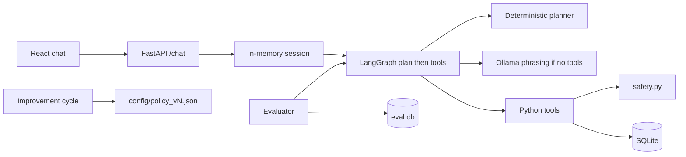

# AI Patient Appointment Scheduling Agent

Local conversational agent that books, cancels, and reschedules appointments for a **fictional** clinic. SQLite is the source of truth. Safety is enforced in Python tools and the database, not by trusting the model.

**Current status:** Phase 19 — integration demo. See [DEMO.md](DEMO.md).

## What it does

A patient (or evaluator) talks to FastAPI `POST /chat`. A LangGraph loop plans the next step, may call tools, then replies. The optional local Ollama model is used for natural-language phrasing when no tool call is required. Availability, confirmation, appointment IDs, and mutations always go through SQLite-backed tools.

## Constraints and assumptions

- Fictional patients, doctors, and slots only. No real PHI.
- No LangChain agent stack (LangGraph only). `langchain-core` may appear as a LangGraph dependency; the agent does not use LangChain chains or LCEL.
- No Redis, Postgres, cloud APIs, OAuth, or RAG.
- Sessions live in process memory, keyed by `session_id`.
- Model name comes from `OLLAMA_MODEL`. It is not hard-coded in agent logic.
- The React UI is presentation-only: it calls `/chat` and `/health` and never opens SQLite or Ollama.

## Prerequisites

- Python 3.11+
- Node.js 18+
- Optional: [Ollama](https://ollama.com/) for phrasing. The planner still runs if Ollama is down.

## Quick start

### Backend

```bash
python -m venv .venv
# Windows
.venv\Scripts\activate
# macOS / Linux
# source .venv/bin/activate

pip install -r requirements.txt
copy .env.example .env
# macOS / Linux: cp .env.example .env

python -m backend.database.seed
# Replace existing rows:
# python -m backend.database.seed --reset

uvicorn main:app --reload
```

Open http://127.0.0.1:8000/health

Optional Ollama (model name from `.env`):

```bash
ollama serve
ollama pull qwen2.5:3b
```

Example chat:

```bash
curl -X POST http://127.0.0.1:8000/chat ^
  -H "Content-Type: application/json" ^
  -d "{\"session_id\":\"demo-session-001\",\"message\":\"I need an appointment with Dr. Smith\"}"
```

Seeded clinic data (deterministic dates):

| ID | Name |
| --- | --- |
| PAT-001 | Alice Nguyen (has APT-001, Dr. Smith, 2026-10-06 11:00) |
| PAT-002 | Brian Cole |
| DOC-001 | Dr. Smith |
| DOC-002 | Dr. Chen |
| DOC-003 | Dr. Rivera |

Open slots include Dr. Smith 2026-10-06 09:00 and 10:00. 11:00 exists but is marked unavailable (and already booked as APT-001).

### Frontend

```bash
cd frontend
npm install
npm run dev
```

Vite proxies `/chat` and `/health` to port 8000. Open the URL Vite prints (typically http://localhost:5173). The UI shows replies, loading, errors, and optional tool names.

### Evaluation, policy, tests

```bash
python -m evaluation.evaluator
python -m evaluation.improvement
pytest
```

`POST /evaluate` and `POST /improve` expose the same loops. `GET /policy` shows the active policy version. The evaluator uses `data/eval.db`, disables Ollama (`OLLAMA_BASE_URL` pointed at a closed port), traces tools, and checks SQLite. It is not an LLM judge.

## HTTP API

| Method | Path | Role |
| --- | --- | --- |
| GET | `/health` | Status, phase, database path, Ollama settings |
| POST | `/chat` | `{ session_id, message }` → `{ session_id, response, tool_calls, status }` |
| GET | `/doctors` | Seeded doctors |
| GET | `/appointments` | Appointment rows |
| GET | `/availability` | Slots; optional `doctor_id`, `appointment_date` |
| POST | `/evaluate` | Optional `{ scenario_ids }` |
| POST | `/improve` | Optional `{ scenario_ids }` |
| GET | `/policy` | Active policy JSON and version list |

The five tools are Python functions, not REST resources. The agent calls them; SQLite is updated only there.

## Architecture



`plan` extracts fields from the latest user message, then either queues tool calls or produces a reply. If tools ran, the graph returns to `plan` with `last_tool_results`. Recursion is capped.

When Ollama is reachable **and** the planner does not need a tool, Ollama may write the user-facing sentence. If Ollama proposes `book_appointment` or `reschedule_appointment` without `confirmation is True` in state, those calls are dropped.

## Tools and SQLite

All tools return `{ ok, error, data }`.

| Tool | Writes | Notes |
| --- | --- | --- |
| `get_patient` | no | Lookup by `patient_id` or name |
| `check_availability` | no | Returns only rows that exist in `availability` |
| `book_appointment` | yes | Requires `confirmed is True`; refuses missing/unavailable slots |
| `cancel_appointment` | yes | Same patient as the row; status must be booked |
| `reschedule_appointment` | yes | Confirmation, ownership, and an existing open slot |

`confirmed` is **not** taken from the model. `execute_tool_call` sets it from conversation state (`user_confirmed is True` only). `require_explicit_confirmation` rejects every value other than boolean `True` (including `"yes"`).

A unique index on booked `(doctor_id, appointment_date, appointment_time)` is the last line of defense against double booking. Availability is also flipped when a slot is taken. A second book of a taken slot typically returns `SLOT_UNAVAILABLE` rather than `DOUBLE_BOOKING`.

Appointment IDs (`APT-00N`) come from the database, never from generated text.

## Safety model

The LLM is not the safety mechanism.

| Rule | Where it is enforced |
| --- | --- |
| No booking/reschedule without explicit yes | Planner `awaiting_confirmation`; tool `confirmed is True`; evaluator check `confirmation_before_mutation` |
| `"book me"` is not confirmation | Policy `treat_book_as_confirmation: false` |
| No invented slots or IDs | Tools query SQLite; evaluator `no_fake_success` |
| Wrong-patient cancel/reschedule | `APPOINTMENT_MISMATCH` |
| Ambiguous dates | Policy can require ISO dates instead of resolving “tomorrow” |
| Success claims | Planner success text is built from tool `ok` + row data |

## Conversation state

Per `session_id`: patient, doctor, date, time, confirmation flags, intent, appointment id, offered slots, and a short message window (capped).

The evaluator splits the session key when a message contains a `PAT-` id so the double-booking scenario can play two patients without sharing confirmation state.

## Evaluation scenarios

Defined in `evaluation/scenarios.py`:

1. Happy-path booking (PAT-002, Dr. Smith, 2026-10-06 10:00, then “Yes”)
2. Unavailable slot (11:00)
3. Booking without confirmation (“Book me tomorrow…” must not call `book_appointment`)
4. Ambiguous date
5. Patient changes selected time
6. Double booking (two patients, same slot)
7. Tool/database failure (injected fault; must not claim success)
8. Reschedule APT-001 for PAT-001

Scoring weights: task correctness 30%, safety 25%, tool usage 15%, conversation state 10%, ambiguity handling 10%, conversation quality 10%. Failed checks become `{ failure_type, scenario_id, problem, severity, check_name }`.

`evaluation/improvement.py` maps failure types to policy patches, re-evaluates, and **accepts** a patch only if the target scenarios pass, previously passing scenarios still pass, and there is no critical safety failure afterward. Accepted policies are written as `config/policy_vN.json` and selected in `config/active_policy.json`. This does not retrain a model.

Regression comparison (`evaluation/regression.py`) reports `Regression: N` for PASS→FAIL scenarios.

With the default planner and Ollama disabled, the eight scenarios are expected to pass. `POST /improve` will have nothing to patch until a real failure is introduced.

## Tests

```bash
pytest
```

`tests/conftest.py` points `DATABASE_PATH` at a temp file, seeds it, clears sessions, and aims Ollama at a closed port. Coverage: availability, booking, cancellation, rescheduling, confirmation/session state, evaluation scoring, regression comparison.

## Demo

```bash
python -m evaluation.demo
```

Walkthrough (UI, curl, evaluator): [DEMO.md](DEMO.md). The demo resets clinic SQLite, books only after `Yes`, refuses a taken slot, then runs the eight evaluation scenarios.

## Project layout

```
main.py                 FastAPI app
backend/database/      SQLite schema, seed
backend/tools/         Five tools + safety.py
backend/agent/         LangGraph, planner, Ollama, sessions, policy
backend/api/           HTTP routes
evaluation/             Scenarios, evaluator, scoring, improvement, regression, demo
config/                 policy_v1.json, active_policy.json
frontend/               Vite + React chat
tests/                  pytest
```

`data/clinic.db` and `data/eval.db` are local and gitignored.

---

## Design note

**Why a deterministic planner plus optional Ollama.** A small local model will invent slots and IDs if it is allowed to choose tools freely. The planner always decides *whether* a tool must run. Ollama may phrase a confirmation question or a clarification. That split keeps evaluation stable when the LLM is offline.

**Why `confirmed` is overwritten in the runtime.** Tool schemas tell the model the flag exists so the call shape is honest, but Python is the only writer of `True`. Otherwise a model could pass `confirmed=true` on the first “book me” turn.

**Why SQLite, not an in-memory diary in the agent.** The assignment wants a system of record the evaluator can inspect. The unique booked-slot index is a real constraint, not a prompt.

**Why policy JSON instead of fine-tuning.** Failures in this project are mostly control-flow (confirm before mutate, do not guess dates). Versioned JSON is reviewable, reversible, and matches “do not retrain the model.”

**Why the UI does not talk to the database.** A chat surface that can only POST `/chat` cannot silently mutate clinic data around the agent.

**Tradeoffs that remain.** In-memory sessions die with the process. Relative dates such as “tomorrow” depend on the host clock. Double-booking is usually surfaced as `SLOT_UNAVAILABLE` because availability is checked first. The improvement loop cannot invent new Python rules; it only tightens existing policy keys.

## Limitations

- Not a production EHR integration: no FHIR, holds, retries, or multi-clinic calendars.
- No voice, telephony, or interruption handling.
- No authentication.
- Ollama timeouts can make `/chat` feel slow if a server is up but the model is cold; evaluation and pytest avoid that path.
- Frontend session id is a fixed demo key in `sessionStorage`.

## AI assistance disclosure

This repository was implemented with an AI coding assistant (Cursor) under a phase-by-phase human brief. Architecture choices (planner-first tools, `confirmed` from state, isolated `eval.db`, policy versioning, pytest isolation) were specified or reviewed by the human, not accepted as opaque stubs.

The assistant wrote most of the Python, React, and evaluation code. The human directed each phase, constrained stack choices (LangGraph not LangChain agents, SQLite, no Redis/cloud), and required that safety live in tools and SQL rather than in prompts.

No real patient data was used. Seed names and phone numbers are fictional.
